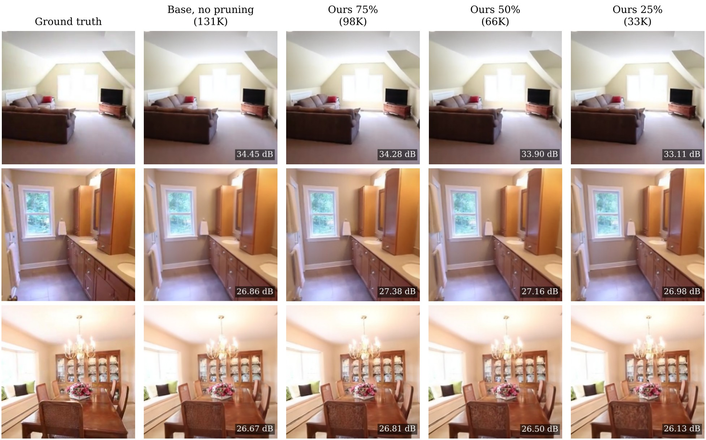
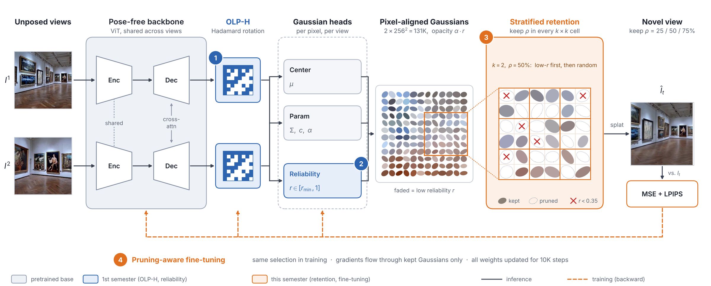
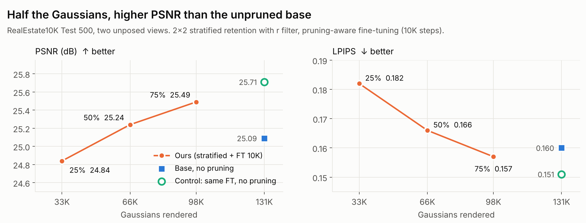
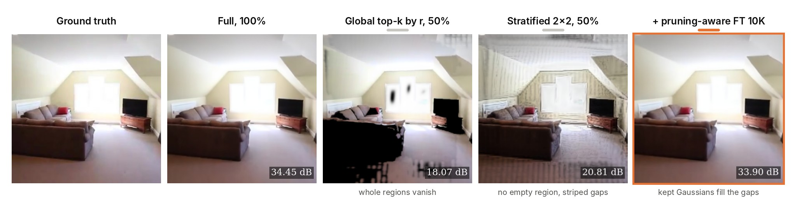
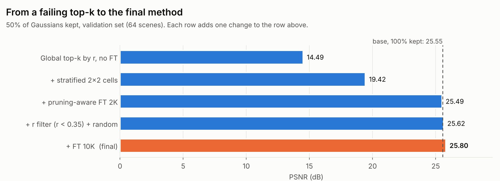
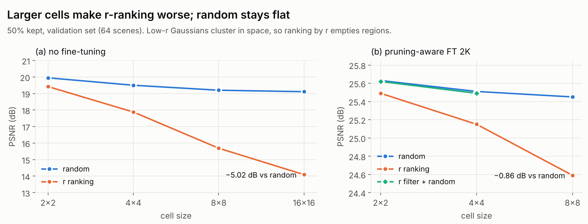
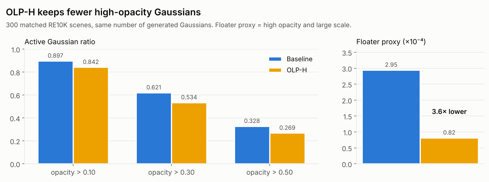
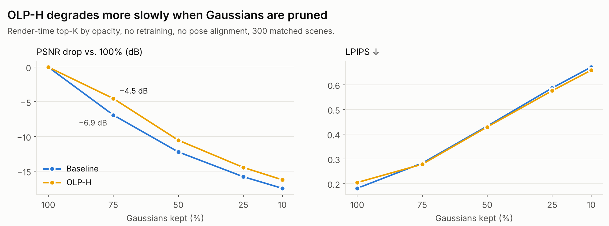
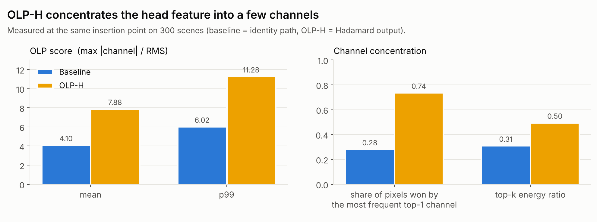

<div align="center">

<h1>Stratified Retention for Compact<br>Pose-free Feed-forward 3D Gaussian Splatting</h1>

**Kyoosuk Hwang** · **Junyoung Kwon**

Seoul National University of Science and Technology (SeoulTech) · Capstone Design 2026

[](#installation)
[](#installation)
[](#installation)
[](LICENSE)

**English** · [한국어](README_KO.md)

</div>

<p align="center">
  
</p>
<p align="center"><sub>
Novel views from <b>two unposed images</b> (RealEstate10K). Keeping 75 / 50 / 25% of the per-pixel Gaussians, our model stays
close to the unpruned base. Per-image PSNR in the corner.
</sub></p>

## News

- **2026-10-30** — Final presentation (Capstone Design 2). Code for stratified retention and pruning-aware fine-tuning released.
- **2026-06-12** — OLP-H and the Gaussian reliability head (Capstone Design 1).

## Abstract

Feed-forward 3D Gaussian Splatting from unposed images predicts one Gaussian per pixel, so two 256×256 views already
produce 131K Gaussians, many of them redundant. We study how to keep only a fraction of them in a single forward pass
without losing quality. On top of a pretrained pose-free model we add **OLP-H**, a fixed randomized Hadamard rotation of
the Gaussian-head feature, and a **reliability head** that predicts a per-Gaussian score *r* and softly scales opacity.
We then show that the natural next step, keeping the global top-k Gaussians by *r*, fails: low-*r* Gaussians cluster in
space, so whole regions vanish (14.49 dB vs. 19.05 dB for random selection at 50%). **Stratified retention** keeps the
same fraction in every 2×2 cell after filtering out Gaussians with *r* < 0.35, so no region is left empty, and
**pruning-aware fine-tuning** lets the remaining Gaussians grow into the gaps. With half of the Gaussians our model reaches
25.24 dB on RealEstate10K (Test 500), 0.15 dB above the unpruned base, while peak render memory drops by 48%. We also find
that *r* measures reliability rather than redundancy, and is better used as a filter than as a pruning ranking.

## Method

<p align="center">
  
</p>

| | Component | What it does | Code |
| :-: | --- | --- | --- |
| ① | **OLP-H** | Rotates each 256-ch head feature by a fixed orthogonal `Q = H·D·P / √C` (Walsh–Hadamard, random signs, channel permutation); no learnable parameters. | [`latent_preconditioner.py`](src/model/encoder/heads/latent_preconditioner.py) |
| ② | **Reliability head** | Predicts `r = r_min + (1 − r_min)·σ(a)` per Gaussian and renders with opacity `α·r`; trained with a context-residual loss. | [`dpt_gs_head.py`](src/model/encoder/heads/dpt_gs_head.py), [`loss_reliability.py`](src/loss/loss_reliability.py) |
| ③ | **Stratified retention** | Splits the pixel grid into *k*×*k* cells and keeps the same fraction ρ in every cell: Gaussians with `r < 0.35` are dropped first, the rest is filled at random. | [`gaussian_retention.py`](src/model/gaussian_retention.py), [`local_cell_retention.py`](src/model/local_cell_retention.py) |
| ④ | **Pruning-aware fine-tuning** | Applies the same selection during training; gradients flow through the kept Gaussians only, and all weights are updated for 10K steps. | [`model_wrapper.py`](src/model/model_wrapper.py) |

Retention happens **before** rasterization, so the renderer only sees ρ·131K Gaussians. Everything is off by default;
with the default config the code reproduces the pretrained base model.

## Results

All numbers use RealEstate10K at 256×256 with two context views. *Base* is the model after ① + ② with all Gaussians;
*Control* is the same base fine-tuned for the same number of steps without pruning.

### Main results — RealEstate10K Test 500

<p align="center">
  
</p>

| Model | Kept | #Gaussians | PSNR ↑ | SSIM ↑ | LPIPS ↓ |
| --- | :-: | :-: | :-: | :-: | :-: |
| Base | 100% | 131K | 25.09 | 0.824 | 0.160 |
| Control (FT 10K, no pruning) | 100% | 131K | *25.71* | *0.843* | *0.151* |
| **Ours** | 75% | 98K | **25.49** | **0.837** | **0.157** |
| **Ours** | 50% | 66K | 25.24 | 0.830 | 0.166 |
| **Ours** | 25% | 33K | 24.84 | 0.817 | 0.182 |

At 50% kept, peak render memory drops from **167 MB to 87 MB (−48%)**. Control is shown in italics: with the same
fine-tuning budget and no pruning it remains 0.47 dB above our 50% model.

### Full RealEstate10K test set — 5,601 scenes

| Model | #Gaussians | PSNR ↑ | SSIM ↑ | LPIPS ↓ |
| --- | :-: | :-: | :-: | :-: |
| Pretrained pose-free base | 131K | 25.06 | 0.839 | 0.161 |
| + OLP-H (300K-step fine-tune) | 131K | 23.80 | 0.794 | 0.181 |
| + Reliability head (+75K steps) | 131K | 24.84 | 0.824 | 0.163 |
| **+ Stratified retention + FT (ours, 50%)** | **66K** | 25.01 | 0.829 | 0.169 |
| Control: FT 10K, no pruning | 131K | 25.45 | 0.842 | 0.155 |

Rows from the first stage were trained with different schedules; read them as a cumulative path.

### Ablation — why stratified retention and fine-tuning

<p align="center">
  
</p>

<p align="center">
  
</p>

| Setting (50% kept, validation 64 scenes) | PSNR ↑ | Δ | LPIPS ↓ |
| --- | :-: | :-: | :-: |
| Base, 100% (no pruning) | 25.55 | – | 0.157 |
| Global top-k by *r*, no FT | 14.49 | −11.06 | 0.389 |
| + Stratified 2×2 | 19.42 | +4.93 | 0.353 |
| + Pruning-aware FT 2K | 25.49 | +6.07 | 0.165 |
| + *r* filter (*r* < 0.35) + random fill | 25.62 | +0.13 | 0.161 |
| + FT 10K (**final**) | **25.80** | +0.18 | **0.158** |

Without fine-tuning, applying the same selection to the control model gives only 19.56 dB, so pruning-aware
fine-tuning is required.

### Is *r* a good pruning score?

<p align="center">
  
</p>

Ranking by *r* inside larger cells falls further behind random selection (−0.14 → −0.86 dB after FT, −0.53 → −5.02 dB
without). Low-*r* Gaussians are spatially clustered, and *r* was trained to suppress floaters, not to predict the cost of
removing a Gaussian. Training *r* with an explicit budget loss gains 0.12–0.32 dB over random on the same model, but still
stays 0.3 dB below random selection with fine-tuning (25.51 dB). The final model therefore uses *r* only as a filter.

<details>
<summary><b>Cell-size sweep table</b></summary>

| Cell | *r* ranking (no FT) | Random (no FT) | *r* ranking (FT 2K) | Random (FT 2K) | *r* filter + random (FT 2K) |
| :-: | :-: | :-: | :-: | :-: | :-: |
| 2×2 | 19.42 | 19.95 | 25.49 | 25.63 | 25.62 |
| 4×4 | 17.88 | 19.50 | 25.15 | 25.51 | 25.49 |
| 8×8 | 15.69 | 19.20 | 24.59 | 25.45 | – |
| 16×16 | 14.09 | 19.11 | – | – | – |

</details>

<details>
<summary><b>Analysis of the first stage (OLP-H and reliability)</b></summary>
<br>

OLP-H lowers the share of high-opacity Gaussians and a floater proxy (high opacity and large scale), and degrades more
slowly when Gaussians are removed at render time without retraining.




The OLP-H output is strongly channel-concentrated, although the scene-level correlation with the floater proxy is weak.




Raw metrics: [`results/reliability_residual/`](results/reliability_residual/README.md) ·
analysis notes: [`experiment_records/`](experiment_records/README.md)
</details>

## Installation

Tested with Python 3.10, PyTorch 2.1.2 and CUDA 11.8.

```bash
git clone https://github.com/junyoung6215/olph-reliability-splat
cd olph-reliability-splat

# creates the conda env and builds the Gaussian rasterizer for CUDA 11.8
bash scripts/create_cuda118_env.sh
conda activate noposplat-olp-cuda118
```

## Data

We use RealEstate10K in the chunked format described in [DATASETS.md](DATASETS.md). Evaluation indices are in
[`assets/`](assets/); `evaluation_index_re10k.json` is the full test split.

## Checkpoints

The pretrained pose-free base checkpoint is downloaded with

```bash
bash scripts/download_re10k_checkpoint.sh      # -> pretrained_weights/re10k.ckpt
```

| Model | Description | Download |
| --- | --- | :-: |
| OLP-H + Reliability | stage 1 (① + ②) | coming soon |
| Ours, ρ = 50% | stage 2 (③ + ④) | coming soon |

## Training

Training runs in two stages on a single GPU.

**Stage 1 — OLP-H and reliability head (① + ②)**

```bash
# OLP-H fine-tuning from the pretrained base
CUDA_VISIBLE_DEVICES=0 bash scripts/run_re10k_olp_ft.sh

# reliability head with the context-residual loss (75K steps)
CUDA_VISIBLE_DEVICES=0 BASE_CKPT=/path/to/olph.ckpt DATA_ROOT=/path/to/re10k \
bash scripts/run_re10k_reliability_residual_ft.sh
```

**Stage 2 — stratified retention with pruning-aware fine-tuning (③ + ④)**

Copy [`config/experiment_runs/retention_suite.yaml`](config/experiment_runs/retention_suite.yaml), fill in the paths and
set the final retention settings:

```yaml
initial_checkpoint: /path/to/olph_reliability.ckpt   # stage-1 output
reliability_floor: 0.35                              # r filter
local:
  cell_size: 2                                       # 2x2 cells
  stratified: true
  demand_source: uniform
```

```bash
# prints the planned command; add --execute to launch
python scripts/run_retention.py --config my_retention.yaml train \
    --arm control --prune --local --score reliability_filtered --ratio 0.5 --steps 10000 \
    --run-id ours_r50 --execute
```

`--ratio` is the kept fraction ρ. `--train-scope heads` freezes the backbone for shorter pilots.

## Evaluation

```bash
# full RealEstate10K test split; --split test uses the 500-scene held-out index from the YAML
python scripts/run_retention.py --config my_retention.yaml eval-grid \
    --checkpoint /path/to/ours_r50.ckpt \
    --scores reliability_filtered --ratios 0.25 0.5 0.75 --local on --split full --execute

# collect every run into one CSV
python scripts/run_retention.py --config my_retention.yaml summarize \
    --root /path/to/outputs --output results.csv
```

Unit tests run on CPU without data:

```bash
python -B -m unittest discover -s tests -p 'test_*.py' -v
```

## Code structure

```text
src/model/encoder/heads/latent_preconditioner.py   ① OLP-H
src/model/encoder/heads/dpt_gs_head.py             ② Gaussian heads + reliability branch
src/loss/loss_reliability.py                       ② context-residual reliability loss
src/model/gaussian_retention.py                    ③ retention: budgets, scores, r filter, budget loss
src/model/local_cell_retention.py                  ③ cell layout and stratified ranking
src/model/model_wrapper.py                         ④ retention in training and evaluation
src/experiment_runner/retention.py                 train / eval-grid / summarize launcher
config/                                            Hydra configs (all components off by default)
docs/                                              design notes and implementation reports
```

## Limitations and future work

- Our 50% model is still 0.44–0.47 dB below a control fine-tuned for the same steps without pruning.
- At 50% and below, LPIPS is slightly worse than the unpruned base; the largest drops appear on thin structures and
  high-frequency texture (still under analysis).
- *r* is a reliability score, not a pruning score. Next steps: a pruning-specific score, size (MB) and FPS
  measurements, more input views, and other backbones.

## Citation

```bibtex
@misc{hwang2026stratified,
  title        = {Stratified Retention for Compact Pose-free Feed-forward 3D Gaussian Splatting},
  author       = {Hwang, Kyoosuk and Kwon, Junyoung},
  year         = {2026},
  howpublished = {\url{https://github.com/junyoung6215/olph-reliability-splat}},
  note         = {Capstone Design project, Seoul National University of Science and Technology}
}
```

## Acknowledgements

This code builds on [NoPoSplat](https://github.com/cvg/NoPoSplat), which provides the pose-free backbone, data pipeline
and pretrained checkpoint, and in turn on [pixelSplat](https://github.com/dcharatan/pixelsplat),
[DUSt3R](https://github.com/naver/dust3r) and [CroCo](https://github.com/naver/croco). We thank the authors for
releasing their code.

## License

Released under the [MIT License](LICENSE). The base code is © 2024 Botao Ye; our extensions are © 2026 Kyoosuk Hwang and
Junyoung Kwon.
