<div align="center">

# OLP-H + Gaussian Reliability

### Pose-free Feed-forward 3DGS를 위한 floater-aware·budget-robust Gaussian 예측

[](#시작하기)
[](#시작하기)
[](#시작하기)
[](https://github.com/cvg/NoPoSplat)
[](LICENSE)

[English](README.md) · **한국어**

서울과학기술대학교 캡스톤디자인 · 2026<br>
Junyoung Kwon · Kyoosuk Hwang

</div>

---

<p align="center">
  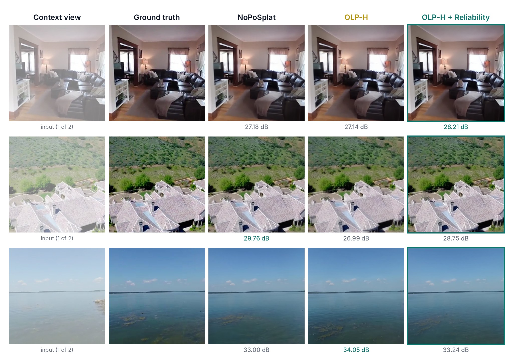
  <br>
  <sub>Pose 없는 RealEstate10K 이미지 2장으로 만든 novel view. 각 이미지 아래는 PSNR이며, 세 모델 중 가장 높은 값을 강조했습니다.</sub>
</p>

[NoPoSplat](https://github.com/cvg/NoPoSplat) 같은 feed-forward 3DGS는 **카메라 pose 없는** 이미지 2장으로
한 번의 forward pass만에 장면을 복원합니다. 하지만 픽셀마다 Gaussian을 하나씩 예측하고 모두 같은 비중으로
렌더링하기 때문에, novel view를 망치는 floater나 신뢰도 낮은 primitive도 그대로 남습니다.

이 프로젝트는 NoPoSplat의 Gaussian head 위에 가벼운 모듈 두 개를 추가합니다.

- **OLP-H (Orthogonal Latent Preconditioner, Hadamard)** — head feature에 고정된 randomized Hadamard
  회전을 적용해, 예측되는 Gaussian 분포를 high-opacity primitive가 적은 쪽으로 바꿉니다.
- **Gaussian Reliability Head** — Gaussian마다 `r ∈ [r_min, 1]` gate를 예측해 opacity를 부드럽게 줄입니다.
  약한 *context residual* 신호로 학습해서, 믿기 어려운 Gaussian을 지우지 않고 흐려지게 만듭니다.

## 핵심 결과

| | |
| --- | --- |
| 🎯 **Floater proxy 3.6배 감소** | High-opacity × large-scale Gaussian 비율 2.95e-4 → 8.16e-5 (동일 300개 장면) |
| 📉 **Active Gaussian 감소** | 같은 개수를 생성해도 opacity > 0.3인 비율이 0.621 → 0.534 |
| 🪶 **Budget에 강함** | 상위 75% Gaussian만 남길 때 NoPoSplat은 PSNR −6.9 dB, OLP-H는 −4.5 dB |
| 🔁 **Reliability로 품질 회복** | 전체 RE10K test set에서 OLP-H 대비 **PSNR +1.04 dB**, LPIPS 0.181 → 0.163 |

## 방법

<p align="center">
  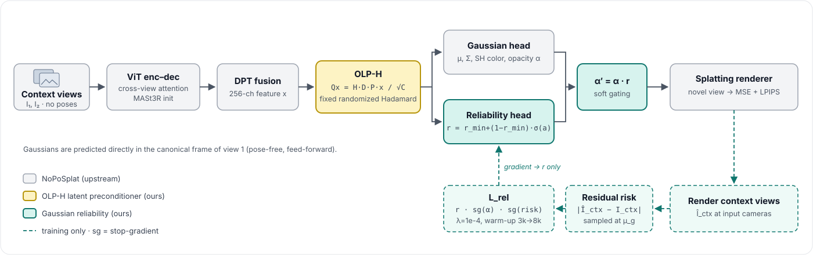
</p>

**OLP-H.** Gaussian parameter head 직전의 256채널 DPT feature `x`를 고정 직교행렬로 회전합니다.

```text
Q x = H · D · P · x / √C        (C = 256)
```

`P`는 seed 고정 channel permutation, `D`는 ±1 random sign, `H`는 Walsh–Hadamard transform입니다.
`Q`는 norm을 보존하고 학습 파라미터가 없으며, fine-tuning 중 identity에서 시작해 warm-up 동안
`mix: 0 → 1`로 섞여 들어가 pretrained head가 적응할 수 있게 합니다.
→ [`src/model/encoder/heads/latent_preconditioner.py`](src/model/encoder/heads/latent_preconditioner.py)

**Gaussian Reliability Head.** 같은 preconditioned feature에서 2층 conv branch(3×3 → ReLU → 1×1)가
Gaussian별 logit `a_g`를 예측합니다.

```text
r_g      = r_min + (1 − r_min) · σ(a_g)        r_min = 0.05, 초기값 r_g ≈ 0.95
α′_g     = α_g · r_g
```

Gaussian을 삭제하지 않고 렌더링 기여도만 조절하므로 완전한 feed-forward 구조가 유지됩니다.
→ [`src/model/encoder/heads/dpt_gs_head.py`](src/model/encoder/heads/dpt_gs_head.py)

**Context-residual reliability loss.** 학습 중 예측한 Gaussian을 *입력* 카메라에서도 렌더링합니다.
픽셀별 residual `|Î_ctx − I_ctx|`를 각 Gaussian 중심의 투영 위치에서 샘플링해 약한 risk 신호로 쓰고,

```text
L_rel = mean_g [ r_g · sg(α_g) · sg(risk_g) ]          λ = 1e-4, 3k → 8k step linear warm-up
```

stop-gradient로 기존 opacity / scale / color 예측은 그대로 두고, gradient가 reliability gate로만 흐르게
합니다. → [`src/loss/loss_reliability.py`](src/loss/loss_reliability.py)

## 실험 결과

모든 실험은 RealEstate10K 256×256, context view 2장 설정입니다.

### 전체 RE10K 평가 — test pair 5,601개, pose alignment 적용

| 모델 | 학습 | PSNR ↑ | SSIM ↑ | LPIPS ↓ |
| --- | --- | ---: | ---: | ---: |
| NoPoSplat (공식 checkpoint) | — | **25.06** | **0.839** | **0.161** |
| OLP-H | NoPoSplat에서 300k step fine-tune | 23.80 | 0.794 | 0.181 |
| **OLP-H + Reliability** | `L_rel`로 75k step 추가 학습 | 24.84 | 0.824 | 0.163 |
| NoPoSplat + reliability head 이식 | fine-tune 없음 | 24.76 | 0.837 | 0.164 |

Reliability head가 OLP-H에서 떨어진 품질 대부분을 회복합니다(+1.04 dB, LPIPS는 NoPoSplat과 0.002 차이).
원본 metric과 run config: [`results/reliability_residual/`](results/reliability_residual/README.md)

### Gaussian compactness — 동일 300개 장면

<p align="center">
  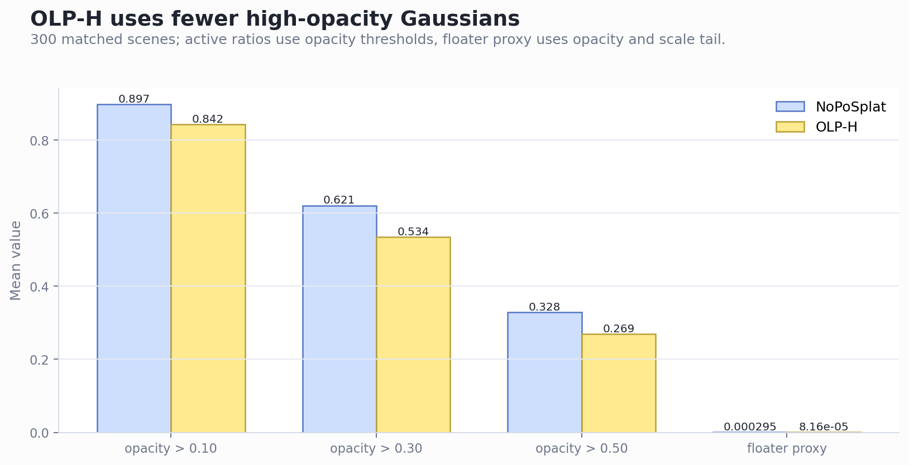
</p>

| 지표 (장면 평균) | NoPoSplat | OLP-H |
| --- | ---: | ---: |
| Opacity 평균 | 0.391 | **0.347** |
| Active ratio @ α > 0.10 | 0.897 | **0.842** |
| Active ratio @ α > 0.30 | 0.621 | **0.534** |
| Active ratio @ α > 0.50 | 0.328 | **0.269** |
| Floater proxy (high α ∧ large scale) | 2.95e-4 | **8.16e-5** |

### Gaussian budget 제한에서의 강건성

렌더링 시점에 opacity 기준 top-K만 남기는 실험입니다(재학습 없음, pose alignment 없음, 동일 300개 장면).

<p align="center">
  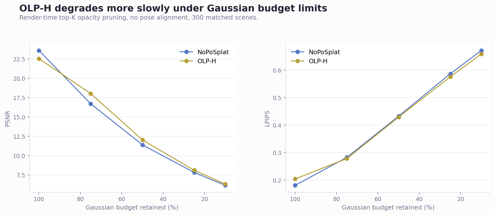
</p>

| 남긴 Gaussian | 100% | 75% | 50% | 25% | 10% |
| --- | ---: | ---: | ---: | ---: | ---: |
| NoPoSplat ΔPSNR | 0.00 | −6.90 | −12.22 | −15.79 | −17.46 |
| OLP-H ΔPSNR | 0.00 | **−4.52** | **−10.53** | **−14.45** | **−16.23** |

### 정성 결과 — 오차가 어디서 생기는가

픽셀별 error map입니다(밝을수록 오차가 큼). OLP-H만 쓰면 지붕 모서리와 가구 경계에서 오차가 늘어나고,
이 장면들에서는 reliability head가 그 상당 부분을 줄입니다.

<p align="center">
  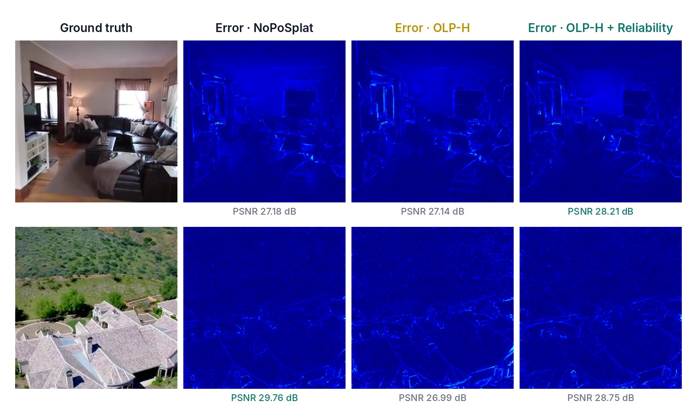
</p>

<details>
<summary><b>장면 더 보기</b> (context · GT · NoPoSplat · OLP-H · OLP-H + Reliability, 아래 줄은 error map)</summary>
<br>

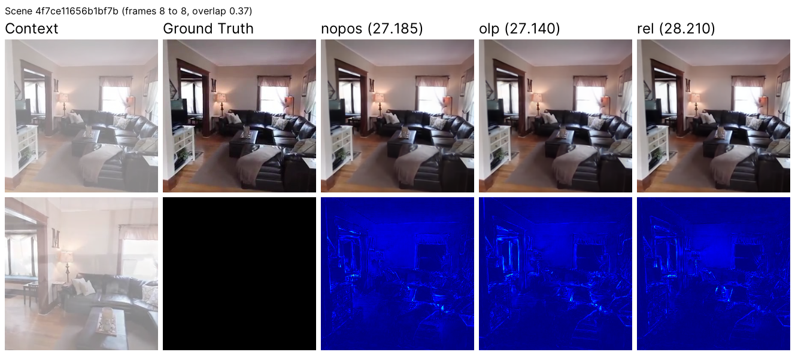
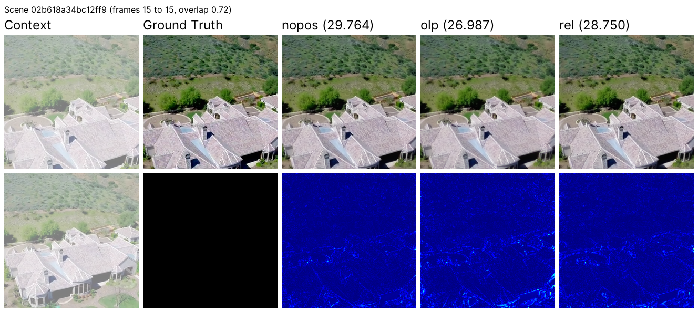
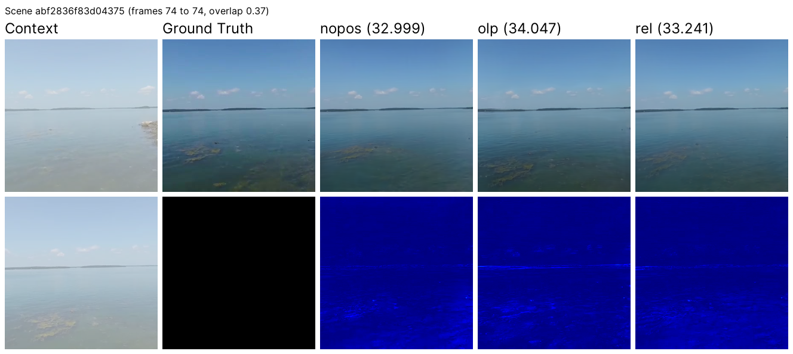
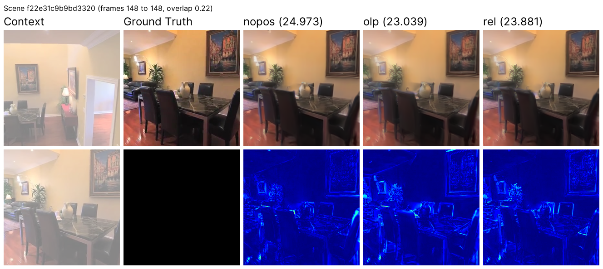
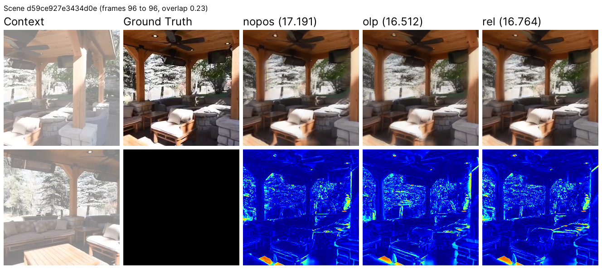

마지막 두 장면은 overlap이 낮은(0.22–0.23) pair로, 세 모델 모두 어려워합니다.

</details>

### 분석 — OLP-H가 latent에 하는 일

같은 삽입 위치에서 측정하면 OLP-H 출력은 NoPoSplat의 identity 경로보다 채널 집중도가 훨씬 높습니다.
한 장면에서 가장 자주 1등인 채널이 픽셀의 74%를 차지하고(NoPoSplat 28%), OLP score(최대 채널 / RMS)는
거의 두 배가 됩니다.

<p align="center">
  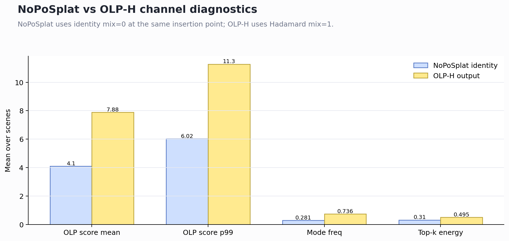
</p>

<details>
<summary>OLP score가 가장 높은 장면의 <b>channel outlier map</b></summary>
<br>
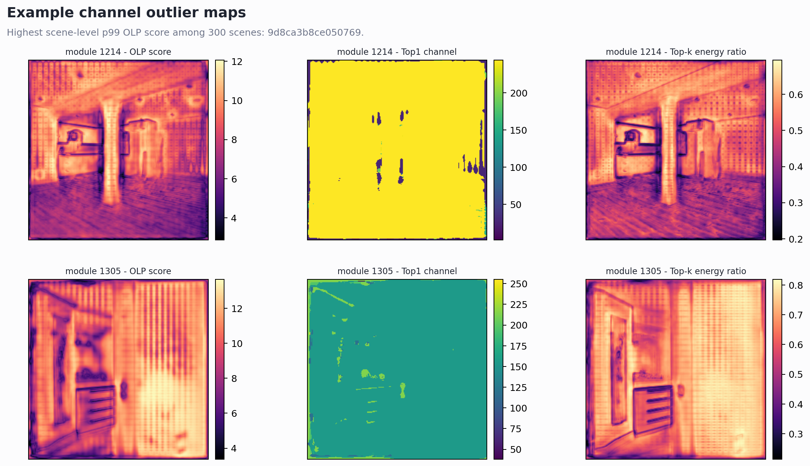
</details>

### 정리와 한계

- OLP-H 단독으로는 표준 benchmark에서 품질 향상이 **아닙니다**(공식 NoPoSplat 대비 −1.25 dB).
  가치는 Gaussian 분포를 바꾸고 pruning에 더 잘 버티게 한다는 점에 있습니다.
- Floater proxy는 opacity·scale tail 기반 휴리스틱이고, floater 정답 라벨이 아닙니다.
- OLP-H 출력에는 강한 채널 집중이 있지만, 장면 단위 floater proxy와의 상관은 약해서(r ≈ 0) 인과관계는
  아직 열려 있습니다([분석 노트](experiment_records/home_data_olp_h_300_20260611/extra/home/data/olp_h_re10k_slot0/noposplat_eval/re10k/olp_h_300_20260611/analysis/labmeeting_20260612_olp_h_analysis.md)).
- NoPoSplat 수치는 더 큰 batch로 학습한 공식 checkpoint이고, 우리 fine-tune은 GPU 1장(batch 4,
  gradient accumulation)에서 돌렸습니다.
- Checkpoint는 아직 공개하지 않았습니다.

## 레포 구조

```text
src/model/encoder/heads/
  latent_preconditioner.py   OLP-H 모듈 (randomized Hadamard, warm-up mix, latent 통계)
  preconditioner_*.py        FWHT 연산, config, channel outlier 통계
  dpt_gs_head.py             Gaussian head + reliability branch + opacity gating
  reliability_cfg.py         reliability head config
src/loss/
  loss_reliability.py        context-residual reliability loss (L_rel)
src/model/gaussian_retention.py   렌더링 시 Gaussian budget / top-K retention
src/analysis/                평가 중 OLP-H 통계 기록
config/                      Hydra config (OLP-H, reliability는 기본 off)
scripts/                     학습 / 평가 / 분석 실행 스크립트
tests/                       OLP-H, reliability loss, retention 단위 테스트
results/, experiment_records/   위 실험의 metric, config, 그림
docs/                        실험 프로토콜, upstream 대비 변경 보고서, 서버 runbook
```

추가한 기능은 모두 opt-in이라, 기본 config에서는 upstream NoPoSplat과 똑같이 동작합니다.
파일 단위 변경 내역은 [`docs/OLP_H_DIFF_REPORT_KO.md`](docs/OLP_H_DIFF_REPORT_KO.md)에 있습니다.

## 시작하기

```bash
# 1. 환경 (PyTorch 2.1.2 + CUDA 11.8, diff-gaussian-rasterization 빌드 포함)
bash scripts/create_cuda118_env.sh
conda activate noposplat-olp-cuda118

# 2. NoPoSplat 공식 RE10K checkpoint -> pretrained_weights/re10k.ckpt
bash scripts/download_re10k_checkpoint.sh

# 3. 데이터셋: DATASETS.md 참고 (RealEstate10K)
```

**OLP-H fine-tune → reliability head 학습**

```bash
CUDA_VISIBLE_DEVICES=0 bash scripts/run_re10k_olp_ft.sh

CUDA_VISIBLE_DEVICES=0 \
BASE_CKPT=/path/to/olp_h_300k.ckpt DATA_ROOT=/path/to/re10k \
bash scripts/run_re10k_reliability_residual_ft.sh
```

**평가** (전체 RE10K test split)

```bash
CUDA_VISIBLE_DEVICES=0 \
BASE_CKPT=/path/to/olp_h_300k.ckpt REL_CKPT=/path/to/olp_h_reliability_75k.ckpt \
DATA_ROOT=/path/to/re10k \
bash scripts/run_re10k_reliability_residual_eval.sh
```

**단위 테스트** (데이터셋 불필요)

```bash
python tests/test_olp_preconditioner.py
python tests/test_reliability_loss.py
```

Upstream 설치·데이터셋·checkpoint 안내: [`docs/NOPOSPLAT_UPSTREAM_README.md`](docs/NOPOSPLAT_UPSTREAM_README.md)

## 더 읽을거리

| 문서 | 내용 |
| --- | --- |
| [README_OLP_H_KO.md](README_OLP_H_KO.md) | OLP-H 설정과 실행 방법 |
| [README_GAUSSIAN_RELIABILITY_KO.md](README_GAUSSIAN_RELIABILITY_KO.md) | Reliability head 설계와 loss 로드맵 |
| [docs/OLP_H_EXPERIMENT_PROTOCOL_KO.md](docs/OLP_H_EXPERIMENT_PROTOCOL_KO.md) | 전체 실험 프로토콜 |
| [docs/OLP_H_DIFF_REPORT_KO.md](docs/OLP_H_DIFF_REPORT_KO.md) | NoPoSplat 대비 변경 사항 |

## 팀

**Junyoung Kwon** ([@junyoung6215](https://github.com/junyoung6215)) · **Kyoosuk Hwang**<br>
서울과학기술대학교 캡스톤디자인, 2026.

## 감사의 말

이 프로젝트는 Ye et al.의 [NoPoSplat](https://github.com/cvg/NoPoSplat)을 기반으로 하며, NoPoSplat은
[pixelSplat](https://github.com/dcharatan/pixelsplat), [DUSt3R](https://github.com/naver/dust3r) /
[MASt3R](https://github.com/naver/mast3r), [CroCo](https://github.com/naver/croco)를 기반으로 합니다.
코드와 모델을 공개해 준 저자들께 감사드립니다.

```bibtex
@article{ye2024noposplat,
  title   = {No Pose, No Problem: Surprisingly Simple 3D Gaussian Splats from Sparse Unposed Images},
  author  = {Ye, Botao and Liu, Sifei and Xu, Haofei and Li, Xueting and Pollefeys, Marc and Yang, Ming-Hsuan and Peng, Songyou},
  journal = {arXiv preprint arXiv:2410.24207},
  year    = {2024}
}
```

## 라이선스

MIT — [LICENSE](LICENSE) 참고. 원본 NoPoSplat 코드는 © 2024 Botao Ye, OLP-H와 reliability 확장은
© 2026 Junyoung Kwon, Kyoosuk Hwang.
